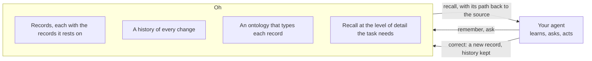

# Oh

> 🧾 Oh is a memory framework with a unique ontology-driven approach. An agent's
> memory becomes typed entities, relations, and facts, each carrying its history
> and the records it came from. Recall returns the right level of detail for
> the task, every memory traces back to its source, and anything wrong can be
> corrected in place. Oh keeps the records and the history; your harness keeps
> the policy.
>
> Ask your agent to set it up: https://oh.computer
>
> — Ben Guo

[](https://skills.sh/hraness/oh)

Oh is a memory framework for agents with an ontology-driven approach. Every memory keeps its history and the records behind it, so agents recall with context and you can trace and correct what they know.

It is for developers whose agents get asked why. You get a TypeScript SDK, a
CLI, and an Agent Skill. All three read and write the same versioned records
and the same append-only log of operations. The default store is one SQLite
file on your machine: it needs no account and no hosted model, and its search
indexes can be deleted and rebuilt.

[Website](https://oh.computer) · [Versioned specification](spec/README.md) ·
[Agent Skill](skills/oh/SKILL.md)

Latest release: [v0.14.1](https://github.com/hraness/oh/releases/tag/v0.14.1)
on [npm](https://www.npmjs.com/package/@hraness/oh), free and MIT licensed.

## Why Oh

- **An ontology, not a pile of notes.** Every record declares a kind from a
  versioned ontology (entity, statement, assertion, evidence, context, inquiry,
  projection), a stable key, the keys it depends on, and its content as
  canonical JSON, so equal content always has the same SHA-256 digest. Oh
  checks the shape and the references on every write.
- **Every memory keeps its history.** A write names the head it expects and
  fails if another writer moved it first. Accepted operations are digested,
  chained to their parent, and never rewritten, so `oh verify` replays the
  history and compares it with the records.
- **Recall at the level of detail the task needs.** Search and recall return
  records with the records they rest on. The progressive memory context reads
  the same history as summaries your code publishes, and any summary opens
  back into the originals it covers.
- **Correct it in place.** A wrong memory gets a new record under the head you
  reviewed; the old one stays in the history, so later work and earlier
  answers can both be explained.
- **The file you control is the source of truth.** Records and operations live
  in one SQLite file. Sync is a step you call, with a transport you supply, and
  it applies only a history that extends yours. Keyword and semantic indexes
  are copies rebuilt from the records.
- **Your code keeps the policy.** Oh stores and recalls; your application
  decides which space an agent writes to, what moves from working memory into
  reviewed memory, and which model answers. See
  [Give an agent working memory](docs/working-memory.md).

## How it works



Your agent remembers and asks through the SDK, the CLI, or the Agent Skill.
Oh writes each record with its kind and dependencies, appends the operation to
the space's history, and answers a question with the records and the records
behind them. When an answer is wrong, a correction is one more write under the
head you reviewed. [Progressive memory context](docs/memory-context.md)
explains how a host publishes summaries over that history and expands them
back into the originals.

## Find the right documentation

- **Install and try it:** [Install and first run](#install-and-first-run),
  then [Troubleshooting the first run](#troubleshooting-the-first-run).
- **Build on it in TypeScript:** [Use the SDK](#use-the-sdk), then
  [Call Oh from TypeScript](docs/sdk.md) and
  [Search and recall](docs/search.md).
- **Give an agent memory:** [Give an agent working memory](docs/working-memory.md),
  [Progressive memory context](docs/memory-context.md),
  [Memory pages and `.oh.md` files](docs/memory-pages.md), and
  [How memory host calls run](docs/memory-runtime.md).
- **Hand Oh to a coding agent:** the [Oh Agent Skill](skills/oh/SKILL.md).
- **Store data somewhere other than a local file:**
  [Direct libSQL store](docs/libsql-runtime.md) and
  [Fast-forward sync](docs/sync-runtime.md).
- **Run semantic search:**
  [Local semantic backend lifecycle](docs/semantic-lifecycle.md) and
  [Hosted semantic cache V2 lifecycle](docs/hosted-semantic-runtime.md).
- **Derive facts with rules:** [Derive facts with rules](docs/projections.md).
- **Store research sources:** [The research profile](docs/research-profile.md).
- **Work with a Markdown vault:** [Oh and Wordcell](docs/wordcell.md).
- **Implement or change a contract:** start at the
  [specification map](spec/README.md), then read the version 1 text and its
  JSON Schema together.
- **See where Oh is headed:** [docs/plans](docs/plans/north-star.md) holds
  plans, not shipped behavior.
- **Contribute or report a vulnerability:** [CONTRIBUTING.md](CONTRIBUTING.md)
  or the private process in [SECURITY.md](SECURITY.md).

## Install and first run

The archive below is `0.14.1`, the
[verified public release](https://github.com/hraness/oh/actions/runs/36816606531).

[Bun 1.3.14 or newer](https://bun.sh/docs/installation) is required for the
CLI, the SDK, and the SQLite store. The runtime-neutral store interfaces and the
direct libSQL store also run on Node 24 and in serverless functions. Install
the release from npm:

```sh
bun add --global @hraness/oh@latest
oh --help
```

The same package bytes and their checksum are attached to the
[immutable GitHub Release](https://github.com/hraness/oh/releases/tag/v0.14.1):
[`hraness-oh-0.14.1.tgz`](https://github.com/hraness/oh/releases/download/v0.14.1/hraness-oh-0.14.1.tgz)
and
[`SHA256SUMS`](https://github.com/hraness/oh/releases/download/v0.14.1/SHA256SUMS).

Oh 0.14.1 and newer update their own Bun and npm global installs on macOS
and Linux. `oh update disable` keeps a version;
[update controls and supported installations](docs/cli-updates.md) has the
details.

The package runs wherever Bun runs. Its native SQLite snapshot helper
(`@hraness/oh/sqlite-snapshot`) is prebuilt for macOS on Apple silicon and
Intel, Linux x64 and arm64, and Windows x64.

Oh writes to `.oh/oh.sqlite` and the `default` space unless you choose another
path or space. `oh init`, `oh put`, and `oh sync import` create that directory,
file, and space if they are missing; reading commands stop with
`No Oh store at .oh/oh.sqlite` instead. Keep `.oh/` out of source control.

```sh
oh init
oh put \
  --kind entity \
  --key entity:ada-lovelace \
  --value '{"name":"Ada Lovelace","role":"mathematician"}'
oh get entity:ada-lovelace
oh search "mathematician"
oh verify
```

This stores one entity, reads it back, finds it through the keyword index, and
replays the log to check it. It needs no account, hosted model, remote
database, or semantic-search package. In a terminal each command prints a short
result, such as `✓ Saved entity:ada-lovelace (generation 1).` Add `--json` for
canonical JSON; `oh get entity:ada-lovelace --json` prints the record on one
line, shown here with line breaks added:

```json
{
  "dependencies": [],
  "key": "entity:ada-lovelace",
  "kind": "entity",
  "recordSha256": "fcfe318e7248366d2408d1fa392268ac16490e72487079956c20db96b8369449",
  "v": 1,
  "value": { "name": "Ada Lovelace", "role": "mathematician" }
}
```

The digest is the same on every machine because it covers only the record.
`oh verify --json` ends with `"operations":1,"records":1,"sqliteIntegrity":"ok"`.

The CLI may print an occasional note about optional development support on
stderr. It never changes stdout or exit codes, CI turns it off, and
[Optional development support](docs/development-support.md) explains how to
switch it off yourself.

## Choose the store and space

| Option | Default | Effect |
| --- | --- | --- |
| `--db <path>` | `.oh/oh.sqlite` relative to your current directory | Selects the SQLite file for this command. |
| `--space <id>` | `default` | Selects the graph and operation history within that file. |
| `--json` | Automatic in a recognized agent environment | Prints canonical JSON instead of terminal text. |

Repeat `--db` and `--space` on each command when you use a nondefault store.
For example, `oh get entity:ada-lovelace --db /absolute/path/memory.sqlite --space default`
reads that file regardless of your current directory. Continue with the
[TypeScript SDK](#use-the-sdk) or [working-memory guide](docs/working-memory.md)
when you need to use these records from an application.

## Troubleshooting the first run

| Symptom | What to check next |
| --- | --- |
| `No Oh store at ...` | Check your current directory and `--db` path. Run `oh init` only if you intend to create a store there; reads do not create one. |
| `No record named ...` (exit 3) | Run `oh list` with the same `--db` and `--space` as the write, then check the record key. |
| JSON appears instead of terminal text | An agent environment selects JSON automatically. Set `HRANESS_AUDIENCE=human` for terminal text, or pass `--json` when parsing results. |
| `OhConflictError`: `The expected head does not match the current space head.` | Another write moved the head after you read it. Read the new head and records, reconcile your change, and submit it again with the new head. See [Handle errors](docs/sdk.md#handle-errors). |

`oh verify` checks saved history and SQLite integrity, not the truth of a fact.
If verification fails, preserve the database and error output rather than
reinitializing it. See the [storage specification](spec/v1/storage.md) for the
record and history contracts.

## How Oh behaves

Commands print short text for people and canonical JSON with `--json`. When an
agent runs Oh (Claude Code, Codex, Cursor, Gemini CLI, or `AI_AGENT` is set),
JSON is the default; `HRANESS_AUDIENCE=human` or `agent` overrides the guess.
`oh sync export` and `oh contract` always print JSON. A missing `oh get` or
`oh tombstone` record exits with status 3. A mistyped command or option exits
with status 2. A missing store, an integrity failure, or a concurrent head
conflict exits with status 1 and leaves the log as it was. Errors name what
went wrong and the command to run next; with `--json` they are one
`{"ok":false,"error":{...}}` object on stdout.

`oh contract` prints the ontology, graph, schema, and SQLite versions compiled
into the installed runtime. Opening a database checks that the contract stored
in it matches that runtime, and refuses to open it otherwise.

A space holds one current graph and one append-only chain of operations:

- A record has a stable key, one declared kind, ordered dependencies, any
  canonical JSON content, and a SHA-256 digest over all of that.
- An operation puts or tombstones (deletes) records in one `BEGIN IMMEDIATE`
  transaction. Before the head moves, the store compares the caller’s expected
  generation and operation digest with the current head and refuses a stale one.
- Each operation’s digest covers its parent operation, the resulting graph
  revision and record set, the contract, the actor, the timestamp, and the
  sequence number.
- The SQLite records and the operation log are the source of truth. The FTS5
  keyword index and local embedding files are copies that can be rebuilt.
- Sync exchanges size-limited bundles of operations after both sides confirm
  the same contract. Only a history that extends the other side’s is applied
  automatically; a divergent history stops with a conflict.
  [Fast-forward sync](docs/sync-runtime.md) shows the libSQL and Turso
  transport. For offline transfer, `oh sync export` writes a bundle to stdout
  and `oh sync import --file <path>` checks it and applies it in one
  transaction, or not at all.

Version 1 of the ontology names seven core ideas: entity, statement,
assertion, evidence, context, inquiry, and projection. The graph format also
carries schema, vocabulary, review, rights, edition, and activity records.
Meaning specific to an application belongs in registered codecs and versioned
schema records, where anyone reading the data can find it.

## Follow a question to its answer

A research application can map familiar work onto Oh records, so each step
of a review is a record you can open:

| Research object | Oh record kind | What you can inspect |
| --- | --- | --- |
| Question | `inquiry` | The question and its durable investigation trail. |
| Source | `entity` | A stable identity for a paper, dataset, person, or system. |
| Capture | `edition` | A size-limited source edition or extract under an application profile. |
| Claim | `statement` | The proposition, separate from who accepts it. |
| Citation | `evidence` | How a passage, table, or observation bears on an assertion. |
| Artifact | `view` | A derived brief or answer with addressable inputs. |

An attributable `assertion` sits between a claim and the evidence that bears on
it. A small review leaves a path you can walk, where a chat answer leaves one
paragraph:

```text
inquiry:primary-endpoint
  → entity:trial-report
  → edition:trial-report-v1
  → statement:endpoint-12-weeks
  → assertion:endpoint-12-weeks
  → evidence:table-2
  → view:review-brief
```

The [homepage trace](https://oh.computer/#trace) shows the CLI read and an
illustrative evidence record that passes its schema. It models how records
point to their sources; it makes no claim about a real study.

For research data there is an optional profile with 14 domain vocabularies,
source-preserving imports from Wikidata captures, and research packets that
Oh validates before storing. [The research profile](docs/research-profile.md)
lists each catalog, the version that added it, and what it covers.

## Use the SDK

For a project dependency, pin the same immutable release in `package.json`:

```json
{
  "dependencies": {
    "@hraness/oh": "0.14.1"
  }
}
```

The base package has no required runtime dependencies. Keyword search,
ontology parsing, SQLite storage, replay verification, and sync need no hosted
model.

```ts
import { Oh } from "@hraness/oh/sdk";

const oh = Oh.open({
  databasePath: ".oh/research.sqlite",
  spaceId: "paper-one",
});

try {
  const head = oh.head();
  oh.put({
    expectedHead: head,
    key: "entity:ada-lovelace",
    kind: "entity",
    value: { name: "Ada Lovelace" },
  });

  const result = await oh.search("Ada", { mode: "keyword" });
  console.log(result.results[0]?.record);
  // Recall fuses several searches and can add records from a date window: spec/v1/recall.md
  console.log((await oh.recall(["Ada", "engine"], { asOf: null })).results.length);
  console.log(oh.verify());
} finally {
  await oh.close();
}
```

Pass the head you reviewed when concurrent writers matter. After an
`OhConflictError`, read the new head and records, reconcile your change, and
submit a new operation; retrying the same call fails the same way.

[Call Oh from TypeScript](docs/sdk.md) covers every SDK method, batch writes,
error classes, and the table of entry points (`@hraness/oh/store`,
`@hraness/oh/libsql`, `@hraness/oh/sqlite`, `@hraness/oh/sync`,
`@hraness/oh/projection`, `@hraness/oh/memory`, and the rest), with the
runtimes each one is tested under.

### Use the best configured retrieval

With no `mode`, search and recall pick the strongest path you have configured:
local reranking when a reranker is present, hybrid keyword and semantic search
when a semantic backend is present, and keyword search otherwise. Pass `mode`
when you need a particular policy or a reproducible comparison. A backend that is missing adds a diagnostic to the
response and leaves the other results in place.
[Search and recall](docs/search.md) shows how to add local embeddings, a local
reranker, or the hosted cache, and what each costs.

## Give Oh to a coding agent

The repository includes an installable Agent Skill at
[`skills/oh`](skills/oh/SKILL.md). The skill teaches an agent to read the
contract and current head, write with the expected generation, verify the
replay, and sync only where you tell it to.

Install the skill from this release with the [skills CLI](https://skills.sh):

```sh
npx skills add hraness/oh#v0.14.1 --skill oh
```

The installer sets up the agents it finds, asking you to choose when there are
several, and asks whether the skill is for the current project or for all your
projects; `--global` chooses all projects. With Claude Code and Codex selected,
it puts the skill in `.agents/skills/oh`, or `~/.agents/skills/oh` for all
projects, where Codex reads it, and links `.claude/skills/oh` or
`~/.claude/skills/oh` to that folder for Claude Code.

To install it by hand, copy the `skills/oh` folder from the installed npm
package (in a project that depends on Oh, it is inside `node_modules`) to
`~/.claude/skills/oh` for Claude Code or `~/.agents/skills/oh` for Codex.
Run `/skills` in either agent to check that `oh` is listed, then ask for it by
name: `/oh` in Claude Code or `$oh` in Codex. These locations and commands come
from the [Claude Code](https://code.claude.com/docs/en/skills) and
[Codex](https://developers.openai.com/codex/skills) skills documentation,
checked October 4, 2026.

You can also give an agent this prompt:

```text
Install @hraness/oh@0.14.1 from npm and use its packaged Oh Agent Skill. The
exact npm tarball and SHA256SUMS are mirrored by the immutable v0.14.1 Release at
https://github.com/hraness/oh/releases/tag/v0.14.1. Verify the CLI with
`oh --help` and `oh version`.
Do not create or modify an Oh database until I name its path and ask you to.
```

## Limits

- Digests detect changed contract, record, operation, and bundle bytes. They do
  not encrypt data, authenticate an actor, authorize a write, or prove that a
  research statement is true.
- Oh does not redact record values. Protect the database, filesystem, backups,
  and any sync destination according to the sensitivity of what you store.
- The optional QMD semantic cache holds text derived from records. Its model
  and inference stay local, but the cache needs the same care as the records.
- The libSQL sync transport checks the contract and that histories extend each
  other. You handle credentials, transport security, access control, tenant
  isolation, backup, retry, and remote availability.
- Divergent histories never merge automatically. Oh reports the conflict and
  leaves reconciliation to you.
- Derived rows and proofs are disposable output. Publishing one as knowledge
  takes an application-level review and a new write to the graph.

Read [SECURITY.md](SECURITY.md) for the full public threat model.

## Benchmarks

Oh measures memory by whether it changed later work: the same reader answers
questions about long conversations with different memory in front of it. On
all 500 [LongMemEval-S](benchmarks/LONGMEMEVAL_S_500_RESULT_V1.md) questions,
completed September 26, 2026, GPT-5 mini answered each question three times and
GPT-4o judged the answers with LongMemEval's prompts:

| Memory in front of the reader | Mean accuracy | Questions correct in at least two of three runs |
| --- | --- | --- |
| Oh semantic retrieval | 88.87% | 445 |
| BM25 keyword retrieval | 86.13% | 431 |
| Lab pipeline: the user's own log plus ranked replies and re-reads | 93.07% | 474 |

On the two-of-three measure, fixed before the runs, Oh leads BM25 by 2.8
points with a 95% interval from 0.0 to 5.6. The lab pipeline is not part of
the package, and its rules were written after the same questions had been
inspected; the [benchmark report](https://oh.computer/blog/longmemeval-s-user-log)
explains how it works and what the study cost.

Earlier studies are kept with their records: the
[SDK retrieval evaluation](benchmarks/SDK_RETRIEVAL_QUALIFICATION_RESULT_V1.md)
(default reranking 80.59% against 69.86% for matched semantic retrieval on 146
development questions), the
[CloneMem reserved-persona study](benchmarks/CLONEMEM_RERANK_CONFIRM_RESULT_V1.md)
(local reranking 77.82% against 70.54% for vector retrieval on 861 questions),
and the [matched framework pilot](benchmarks/FRAMEWORK_PILOT_RESULT_V1.md) on 60
questions. Results that did not pass are kept too; the
[experiment history and reproduction guide](benchmarks/README.md) lists every
study, its dataset digests, and how to rerun it. Retrieval recall, answer
quality, and how an agent writes memory are measured separately.

Run the network-free state and projection checks from a checkout:

```sh
bun run test:benchmarks
bun run bench:memory state
bun run bench:memory projection
```

## Verify a checkout

```sh
bun install --frozen-lockfile --ignore-scripts
bun run check
```

`bun run check` type-checks the package, runs every test, rebuilds the
committed `dist/` entry points, and fails if any tracked file changes.

## Specification

[`spec/manifest.json`](spec/manifest.json) is the machine-readable index of the
contracts. The current contract is version 1:

- [Canonical JSON and digests](spec/v1/canonical-json.md)
- [Ontology](spec/v1/ontology.md)
- [Schema evolution](spec/v1/schema-evolution.md)
- [Graph and operations](spec/v1/graph.md)
- [SQLite storage](spec/v1/storage.md)
- [Store ports, profiles, and direct libSQL authority](spec/v1/store.md)
- [Sync protocol](spec/v1/sync.md)
- [Local embedding profile](spec/v1/embedding.md)
- [Derived projections](spec/v1/projection.md)
- [Compatibility and migration](spec/v1/migration.md)

The JSON Schemas describe the exchanged formats. The runtime parsers also
enforce canonical ordering, byte limits, references between records, and the
exact bytes each digest covers, which JSON Schema cannot express.

## Compare with other memory tools

Most agent memory tools extract facts with a model and host them for you. Oh
stores what you write, without a model rewriting it, in one SQLite file, and
links each record to the records it rests on. The
[comparison page](https://oh.computer/compare) sets Oh beside the hosted and
open-source alternatives with dated sources and the matched benchmark runs.

## Who builds on Oh

Use Oh to build an application’s memory layer. Use Wordcell to maintain and query a Markdown knowledge base.
Each consumer pins an immutable release and upgrades on its own schedule:

- [Wordcell](https://wordcell.io)
  ([source](https://github.com/hraness/wordcell)) is a Markdown knowledge base
  that gives agents the decisions behind code. It rebuilds a disposable Oh graph
  from your Markdown to answer named graph queries with source proofs. The
  Markdown vault is the only source of truth. `wordcell graph rebuild` writes a
  disposable, gitignored `.wordcell/oh.sqlite` copy of the graph, and no query
  or rebuild writes back into notes.
  [How Wordcell uses Oh](https://wordcell.io/blog/how-wordcell-uses-oh).
- [Sponge](https://sponge.computer) runs deep research on your own machine.
  Its earlier hosted library at sponge.computer keeps its research agents’
  working memory in a server-side Oh store, separate from the reviewed
  knowledge in its product database. The hosted library stopped accepting new
  research on September 12, 2026.
  [How Sponge uses Oh](https://sponge.computer/docs/how-sponge-uses-oh).

[Oh and Wordcell](docs/wordcell.md) explains where one ends and the other
begins. Wordcell measures its own search pipeline; Oh’s memory benchmark
scores do not carry over to it.

## Contribute and license

Read [CONTRIBUTING.md](CONTRIBUTING.md) before changing a wire format or a
migration. Report security issues through the private process in
[SECURITY.md](SECURITY.md).

Oh is available under the [MIT License](LICENSE). Notices for the bundled
third-party code are in [THIRD_PARTY_NOTICES.md](THIRD_PARTY_NOTICES.md).
